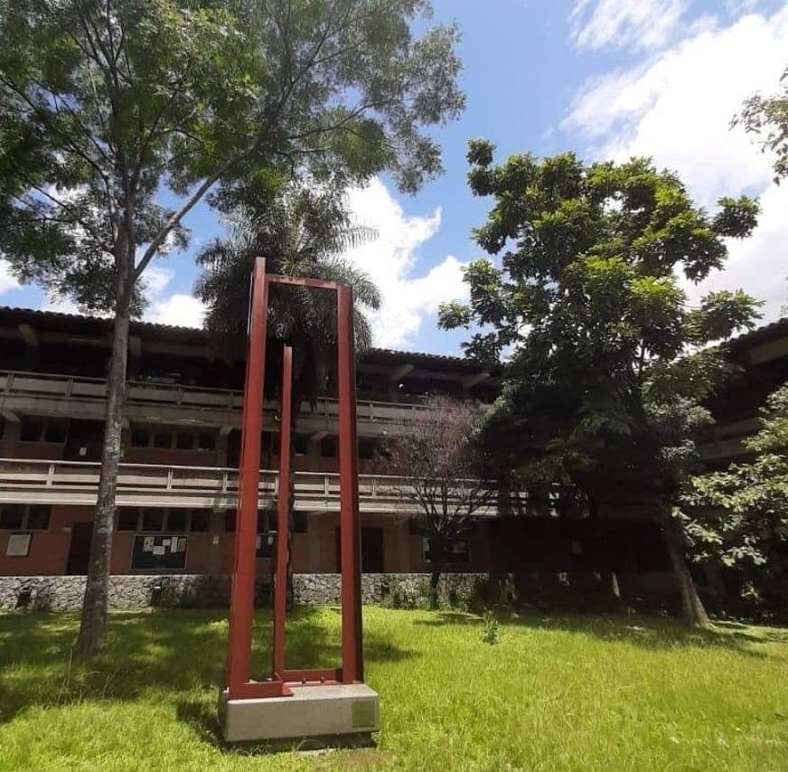

Página oficial con todos los recursos (materiales prácticos y presentaciones) para todos los temas. El material será actualizado al finalizar el curso para resolver errores o dudas.

::: columns
::: {.column width="40%"}
{width="90%"}
:::

::: {.column width="60%"}

### Coordina
Dra. Juliana Herrera Pérez

## Imparte

Dr. Luis D. Verde Arregoitia  

📆 &ensp; 17-20 de noviembre, 2026\
⏰ &ensp;09:00 - 17:00\
🏨 &ensp;Salón 7-103, Facultad de Ciencias Exactas y Naturales, Universidad de Antioquia, Medellín\

:::
:::

