```{r setup}
#| echo: false
library(janitor)
library(tidyr)
library(stringr)
library(dplyr)
library(datos)
library(gt)
library(palmerpenguins)
```

## Temas del bloque:

-   'pipes' y el `tidyverse` 
-   Estructuras y organización de datos\
-   Métodos para reestructurar tablas y archivos\
-   Principios de datos ordenados (**tidy data**) y herramientas del '`tidyverse`' para ordenar datos\

## Más temas:

-   Expresiones regulares para trabajar con cadenas de texto\
-   Herramientas para manejar datos faltantes\
-   Formas de identificar información repetida


## Pipes (\\paips\\)

Si queremos hacer varias operaciones en secuencia:

::: incremental
-   Código anidado (los resultados se evalúan de adentro hacia afuera)

-   Objetos intermedios (creamos objetos con resultados intermedios y para la siguiente función en la secuencia)

-   Pipes (estructuramos operaciones seriadas de izquierda a derecha)
:::

## Código anidado

</br>

::: big-code
```{r}
#| eval: true
#| echo: true

notas <- c(7,8,8,10,6,9,5,9,8)

round(mean(notas), digits = 2)
```
:::

## Objetos intermedios

</br>

::: med-code
```{r}
#| eval: true
#| echo: true
notas_promedio <- mean(notas)

notas_promedio_rd <- 
  round(notas_promedio,
           digits = 2)

notas_promedio_rd
```
:::

## Pipes

::: fragment
::: columns
::: {.column width="30%"}
Mano izquierda\
(LHS)
:::

::: {.column width="40%"}
operador 'pipe'

`%>%`\
de 📦 `magrittr`

`|>` en R v \>= 4.1.0
:::

::: {.column width="30%"}
Mano derecha\
(RHS)
:::
:::
:::

::: fragment
Toma un objeto a la izquierda del operador y lo inserta como argumento en la función a su derecha

\* Por defecto lo que esté a la izquierda del 'pipe' se inserta como el primer argumento de la función
:::

## Pipes

-   Reducen la necesidad de guardar resultados intermedios o de anidar código

-   Código más fácil de leer

-   Más fácil quitar o agregar pasos a la secuencia

> Insertamos con `ctrl + shift + M`

::: rightref
::: refbox
Adolfo Álvarez (2021)\
[The (updated) history of the pipe operator in R](http://adolfoalvarez.cl/blog/2021-09-16-plumbers-chains-and-famous-painters-the-history-of-the-pipe-operator-in-r/)
:::
:::

------------------------------------------------------------------------

</br>

::: big-code
```{r}
#| echo: true
library(magrittr)
notas %>% 
  mean() %>% 
  round(digits=2)
```
:::

::: big-code
```{r}
#| echo: true
notas %>% 
  mean %>% 
  round(digits=2)
```
:::

##

::: big-code
```{r}
#| echo: true
notas |> 
  mean() |> 
  round(digits=2)
```
:::

## 

</br>

::: {style="text-align: center"}
`LHS |> RHS(argument = 12)`

*se convierte en*

`RHS(LHS, argument = 12)`
:::

## Encadenando operaciones


```{r}
#| echo: true
pinguinos |> 
  filter(especie != "Papúa") |> 
  select(especie, isla, starts_with("largo")) |> 
  mutate(proporcion_pico = largo_pico_mm / largo_aleta_mm) |> 
  head()
```

## Agregando información


```{r}
#| echo: true

pinguinos |> 
  filter(!is.na(sexo)) |> 
  group_by(especie, isla) |> 
  summarize(masa_promedio = mean(masa_corporal_g, na.rm = TRUE),
            .groups = "drop") |> 
  arrange(desc(masa_promedio))
```

## tidyverse

::: columns
::: {.column width="20%"}

:::

::: {.column width="80%"}
> ... una colección de paquetes de R diseñados para ciencia de datos. Todos los paquetes comparten una filosofía de diseño, gramática, y estructuras de datos. Su objetivo principal es de 'facilitar una conversación sobre datos entre un humano y su computador'
:::
:::

::: rightref
::: refbox
Wickham et al. (2019)\
[Welcome to the tidyverse](https://www.theoj.org/joss-papers/joss.01686/10.21105.joss.01686.pdf)\
https://www.tidyverse.org/
:::
:::

## tidyverse

-   Para tareas comunes con datos: importar archivos, limpiar datos, transformar, visualizar, o programar nuevas funciones.

-   Diseñado para facilitar su aprendizaje y que los usuarios vayan aprendiendo más funciones conforme interactúen con más elementos de este 'ecosistema'.

::: rightref
::: refbox
Çetinkaya-Rundel et al. ([2021](https://arxiv.org/abs/2108.03510))\
An educator's perspective of the tidyverse
:::
:::

##

](https://www.tidyverse.org/blog/2023/08/teach-tidyverse-23/images/data-science.png)

## tibbles (/tibls/)

Modernizando el `data.frame`

Implementado para todo el `tidyverse` a través de 📦 `tibble`

```{r}
tibble(
  x = c("a", "b", "c"),
  y = c(1, 2, 3)
)
```

. . .

Objeto rectangular común para todos los paquetes del `tidyverse`

## Funciones de `tidyverse`

::: incremental
-   reciben un `data.frame` ➡️ regresan un `data.frame`

-   reciben un `tibble` ➡️ regresan un `tibble`

-   generan un objeto nuevo ➡️ crean un `tibble`
:::

## Creando tibbles

-   Salida predeterminada de funciones

-   Convirtiendo otros objetos con `as_tibble()`

-   Construyendo a partir de vectores con `tibble()`

## tibbles

Para menos ambigüedad:


::: incremental
-   No asignan nombres a las filas

-   No modifican los nombres de las columnas

-   No convierten caracteres en factores

-   Exigen nombres completos para seleccionar subconjuntos de variables con `$`
:::

## Impresión de tibbles

Para no saturar la consola, los métodos de impresión para *tibbles* muestran:

::: incremental
-   Las primeras 10 filas

-   Cuántas filas y columnas no se imprimieron

-   Solo las columnas que entran en el ancho de nuestra pantalla

-   El tipo de variable de todas las columnas
:::

# Organizando información

## ¿Qué problemas vemos con esta presentación de datos? {background-color="#6aa3b8"}

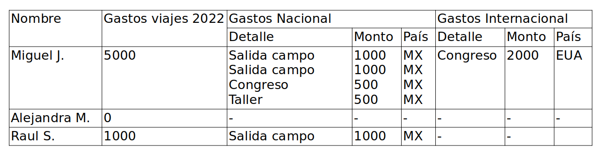

## Más utilizable

```{r}
#| echo: false
viajes <- tibble::tribble(
         ~Nombre, ~Periodo,      ~TipoViaje, ~PropositoViaje, ~Costo, ~Pais,
     "Miguel J.",    2022L,      "Nacional",  "Salida campo",  1000L,  "MX",
     "Miguel J.",    2022L,      "Nacional",  "Salida campo",  1000L,  "MX",
     "Miguel J.",    2022L,      "Nacional",      "Congreso",   500L,  "MX",
     "Miguel J.",    2022L,      "Nacional",        "Taller",   500L,  "MX",
     "Miguel J.",    2022L, "Internacional",      "Congreso",  2000L, "EUA",
  "Alejandra M.",    2022L,              NA,              NA,     NA,    NA,
       "Raul S.",    2022L,      "Nacional",  "Salida campo",  1000L,  "MX"
  ) 

viajes |> gt() |>
    tab_style(
    cell_text(size = "29px"),
    locations = list(
      cells_body(),
      cells_column_labels(everything()),
      cells_title()
    )
  )
```

## 

### ¿Cuánto se gastó en total?

```{r}
viajes |> 
  summarize(Total = sum(Costo, na.rm = TRUE))
```

## 

### ¿Cuántos viajes hizo cada persona?

```{r}
viajes |> 
  count(Nombre)
```

##

### ¿Cuál fue el costo promedio por tipo de viaje?

```{r}
viajes |> 
  group_by(TipoViaje) |> 
  summarize(Promedio = mean(Costo, na.rm = TRUE))
```

## Datos bien organizados

-   Más fácil de importar y manipular

-   Menos potencial de errores no replicables (alteraciones, omisiones, duplicaciones)

Siguiendo buenos principios de organización producimos mejores datos y podremos identificar y resolver problemas en datos existentes

## Recomendaciones

-   Unidades, nombres, esquemas, fechas etc. **consistentes**

-   Nombres utilizables

-   Estructuras rectangulares


::: rightref
::: refbox
::: columns
::: {.column width="33%"}
Openscapes (2020)\
[Tidy data illustrated](https://www.openscapes.org/blog/2020/10/12/tidy-data/)
:::

::: {.column width="33%"}
Broman and Woo (2018)\
[Organizing data in spreadsheets](https://doi.org/10.1080/00031305.2017.1375989)
:::

::: {.column width="33%"}
Verde Arregoita et al. (2018)\
[Good practices for sharing analysis-ready data...](https://doi.org/10.4404/hystrix-00133-2018)
:::
:::
:::
:::

## 


{width="30%"}

[Six Tips for Better Spreadsheets](https://www.nature.com/articles/d41586-022-02076-1)

## Consistencia

Tablas relacionadas con datos sobre seguimiento GPS de aves

::: columns
::: {.column width="50%"}
```{r}
#| echo: false

tibble::tribble(
  ~id,       ~ave,     ~edad,    ~estado,
  23L,  "gorrión", "juvenil",      "VER",
  11L,     "buho",  "adulto", "Veracruz",
   7L,     "buho",       "j",   "Puebla",
  40L, "codorniz",  "ADULTO",       "PU",
  34L,  "gorrión",       "1",      "VER",
  30L,   "paloma",       "A",        "V"
  ) |> gt() |>  
  tab_style(
    cell_text(size = "26px"),
    locations = list(
      cells_body(),
      cells_column_labels(everything()),
      cells_title()
    )
  )

```
:::

::: {.column width="50%"}
```{r}
#| echo: false

tibble::tribble(
  ~ID_ave, ~num_rasteador, ~sexo,
      23L,         "b452",   "M",
      11L,         "b256",   "M",
       7L,         "a122",   "F",
      40L,         "b889",   "M",
      34L,         "d136",   "F"
  ) |> gt() |> 
  tab_style(
    cell_text(size = "26px"),
    locations = list(
      cells_body(),
      cells_column_labels(everything()),
      cells_title()
    ))

```
:::
:::

::: {style="text-align: center"}
¿Cuántas inconsistencias ven aquí?
:::

## Datos rectangulares

::: columns
::: {.column width="30%"}
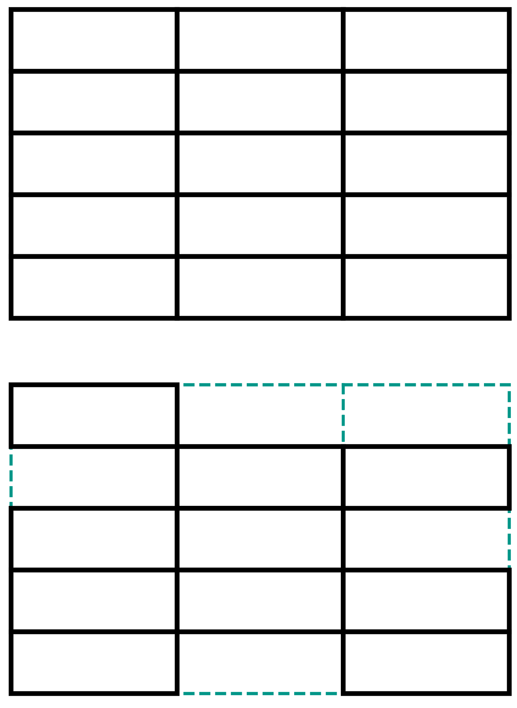
:::

::: {.column width="70%"}
Objetos con filas y columnas, en los cuales:

-   Cada fila tiene el mismo número de columnas

-   Cada columna tiene el mismo número de filas

-   Vectores o factores de la misma longitud entonces todas las columnas tienen la misma 'altura'
:::
:::


## 

<blockquote class="twitter-tweet tw-align-center" data-conversation="none">

<p lang="en" dir="ltr">

but sometimes such data is "rectangular" in the same sense that this cat is "bowl-shaped" 😂 <a href="https://t.co/ZmxvgcV57d">pic.twitter.com/ZmxvgcV57d</a>

</p>

--- Jenny Bryan (@JennyBryan) <a href="https://twitter.com/JennyBryan/status/1126582138344595456?ref_src=twsrc%5Etfw">May 9, 2019</a>

</blockquote>

```{=html}
<script async src="https://platform.twitter.com/widgets.js" charset="utf-8"></script>
```
## 

::: columns
::: {.column width="50%"}
```{r}
#| echo: false
tibble::tribble(
    ~animal, ~ind_observados, ~habitat,
  "caracol",             12L,    "mar",
  "gaviota",             14L,  "costa",
   "nutria",             11L,    "río"
  ) |> gt() |> 
    tab_style(
    cell_text(size = "33px"),
    locations = list(
      cells_body(),
      cells_column_labels(everything()),
      cells_title()
    ))

```
:::

::: {.column width="50%"}
```{r}
#| echo: false
tibble::tribble(
  ~caracol, ~gaviota, ~nutria,
      "12",     "14",    "11",
     "mar",  "costa",   "río"
  ) |> gt() |> 
    tab_style(
    cell_text(size = "33px"),
    locations = list(
      cells_body(),
      cells_column_labels(everything()),
      cells_title()
    ))

```
:::
:::

# Estructurando datos

## ¿Datos listos para uso?

-   Agrupar, transformar, ordenar, visualizar, modelar, compartir, etc.

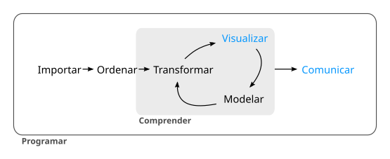{fig-align="center"}

## ¿No se puede?

-   Ordenar para un manejo más fácil y eficiente

## Datos ordenados (*tidy data*)

Una reinterpretación accesible de distintos principios y definiciones de estadística y ciencias de la computación

</br>

::: rightref
::: refbox
Wickham (2014)\
[Tidy Data](https://www.jstatsoft.org/article/view/v059i10/) - Journal of Statistical Software
:::
:::

## 'Tidy data'

-   Datos acomodados en una matriz 2D con filas y columnas

-   Las filas corresponden a observaciones

-   Las columnas corresponden a variables

-   Un solo valor por celda

## 

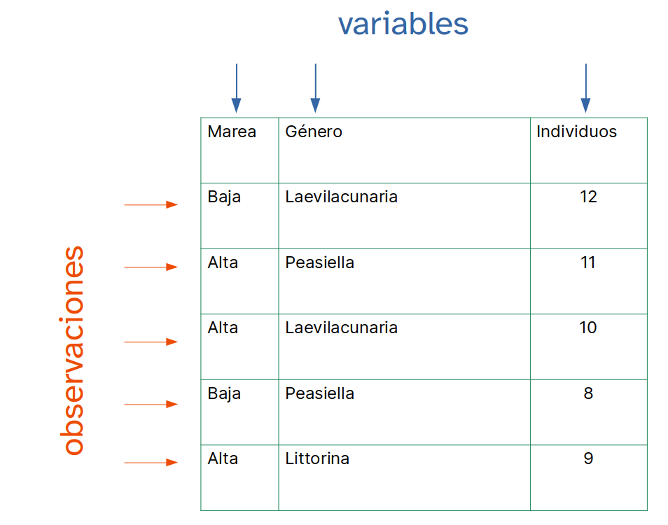{width="90%"}

## 

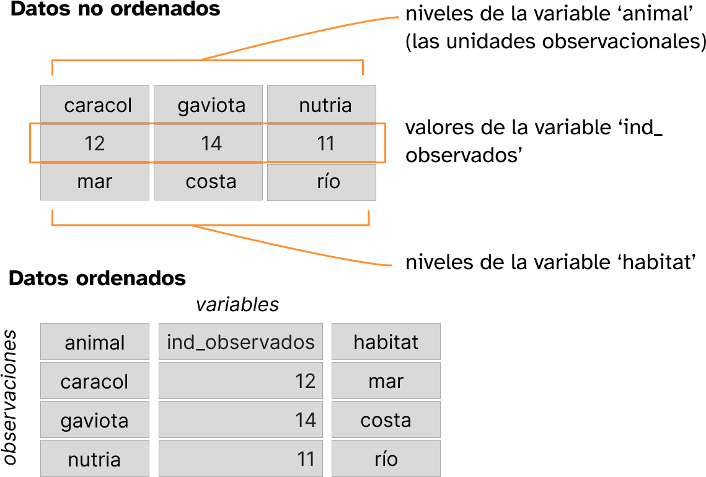

## ¿Para qué?

Más fácil de reacomodar y manejar

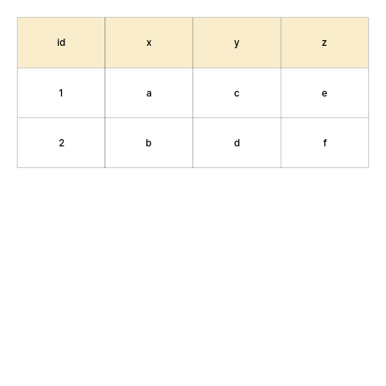

## ¿Para qué?

### Trabajando con filas

Los valores de cada observación quedan juntos

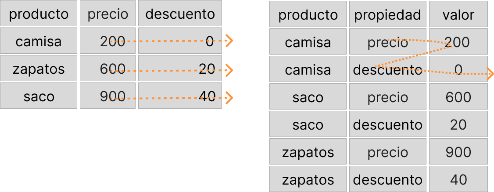

## 

::: columns
::: {.column width="40%"}
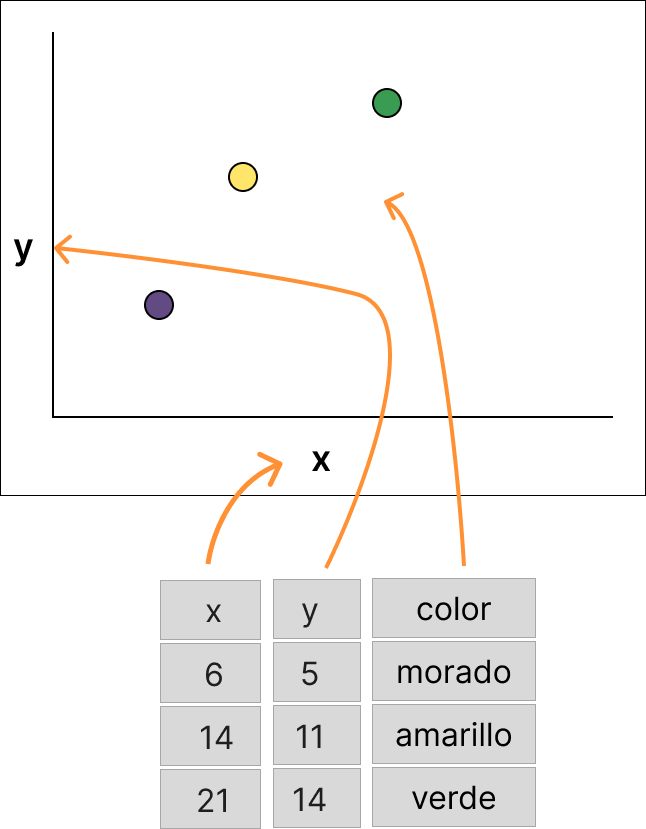
:::

::: {.column width="60%"}
</br> Las variables entran directamente como especificaciones para modelos y/o parámetros gráficos
:::
:::

## Cuándo no

-   Los datos ordenados son más repetitivos y pueden ocupar más espacio que otras representaciones más compactas

</br>

-   No es un formato ideal para la captura de datos, o para tablas que forman parte de algún texto que será impreso

# Consejos rápidos de organización de datos

## Variables por separado para definir grupos

Usar 'variables indicadoras' en lugar de colapsar información entre dos o más variables.

::: columns
::: {.column width="37%"}
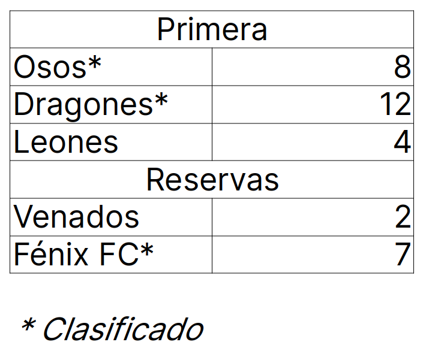
:::

::: {.column width="63%"}
```{r}
#| echo: false

tibble::tribble(
     ~Equipo,      ~Liga, ~Victorias, ~Clasificado,
      "Osos",  "Primera",         8L,         "SI",
   "Venados", "Reservas",         2L,         "NO",
  "Dragones",  "Primera",        12L,         "SI",
    "Leones",  "Primera",         4L,         "NO",
  "Fénix FC", "Reservas",         7L,         "SI"
  ) |> gt()|> 
    tab_style(
    cell_text(size = "32px"),
    locations = list(
      cells_body(),
      cells_column_labels(everything()),
      cells_title()
    ))

```
:::
:::

## Valores faltantes

No se registraron, no aplican, se perdieron, etc.

. . .

</br> [Los datos faltantes siguen siendo datos]{style="font-size: 1.5em; text-align: center"} </br>

En R usamos [NA]{style="color:red; font-family: Liberation Mono; font-weight: bold"}, una constante especial que indica valores faltantes

------------------------------------------------------------------------

-   Tratar los valores [NA]{style="color:red; font-family: Liberation Mono; font-weight: bold"} consistentemente

-   Evitar ambigüedad

> ¿Falta un valor, se dejó una celda en blanco intencionalmente, o la medición no aplica?

-   No usar celdas vacías como relleno para alinear datos o con fines estéticos-estructurales

-   Evitar valores [`NA`]{style="color:red"} en nombres de variables

## 

::: {.columns style="display: flex !important; height: 90%;"}
::: {.column width="50%" style="display: flex; justify-content: center; align-items: center;"}
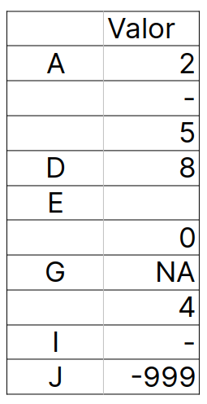
:::

::: {.column width="50%" style="display: flex; justify-content: center; align-items: center"}
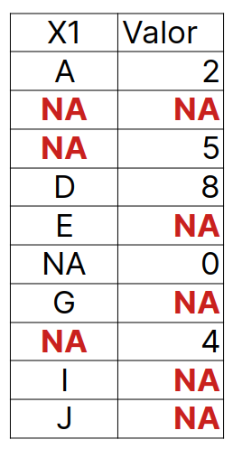
:::
:::

## Encabezados utilizables (nombres de las columnas)

Nombres poco informativos e inconsistentes

```{r}
#| echo: false
#| eval: true

tibble::tribble(
           ~X,     ~x1,            ~X2, ~calif_min, ~CALIFICACION.PROMEDIO,
       "UANL", "Norte", "Arquitectura",         6L,                    8.9,
         "UT", "Norte",       "Diseño",         7L,                   7.78,
      "UABJO",   "Sur",       "Diseño",         6L,                    8.5
      ) |>
  gt() |>
  tab_style(
    cell_text(size = "25px"),
    locations = list(
      cells_body(),
      cells_column_labels(everything()),
      cells_title()
    )
  )
```

-   Más difícil de recordar para hacer referencia a diferentes variables

-   No se ordenan bien (alfa-numéricamente)

## 

```{r}
#| echo: false
#| eval: true


tibble::tribble(
  ~universidad, ~region,          ~area, ~calificacion_minima, ~calificacion_promedio,
        "UANL", "Norte", "Arquitectura",                   6L,                    8.9,
          "UT", "Norte",       "Diseño",                   7L,                   7.78,
       "UABJO",   "Sur",       "Diseño",                   6L,                    8.5
  ) |>
  gt() |>
  tab_style(
    cell_text(size = "25px"),
    locations = list(
      cells_body(),
      cells_column_labels(everything()),
      cells_title()
    )
  )
```

## Nombres de columna partidos

```{r}
#| echo: false
#| eval: true
  
tibble::tribble(
  ~universidad, ~region,          ~area, ~calificacion_, ~calificacion,
            NA,      NA,             NA,      "minima",    "promedio",
        "UANL", "Norte", "Arquitectura",           "6",         "8.9",
          "UT", "Norte",       "Diseño",           "7",        "7.78",
       "UABJO",   "Sur",       "Diseño",           "6",         "8.5"
  ) |> gt() |> 
  tab_style(
    cell_text(size = "25px"),
    locations = list(
      cells_body(),
      cells_column_labels(everything()),
      cells_title()
    )
  )
```

-   Los nombres de las columnas aparecen en \>1 fila

-   Mezcla de fragmentos de nombre con datos

-   Se pierden los separadores entre palabras

-   Se introducen `NA` 

# Herramientas para manipular datos rectangulares

## 🔨 para preparar, transformar, y estructurar datos


📦 **`dplyr`** y 📦 **`tidyr`**


Flexibles, pero desarrollados en torno a una filosofía común

## 

-   Trabas para no usar las funciones incorrectamente\
-   Menos código para lograr un resultado
-   Gramática y estructuras de datos compartidas
-   Tareas divididas entre funciones y paquetes
-   Uso de 'pipes'

## Funciones útiles de 📦 `dplyr`

-   Distintas funciones para las operaciones más comunes

-   Cada función solo hace una cosa pero la hace bien

</br>

-   Funciones intuitivas para:

    -   Crear subconjuntos de filas y columnas

    -   Crear o modificar columnas

## 

```{r}
#| echo: false 
#| eval: true

paises_m <- 
tibble::tribble(
        ~pais, ~especies, ~amenazadas,   ~region,
  "Indonesia",      670L,        191L,    "Asia",
     "Brasil",      648L,         80L, "America",
      "China",      551L,         73L,    "Asia",
     "Mexico",      523L,         96L, "America",
       "Peru",      467L,         53L, "America",
      "Congo",      430L,         15L,  "Africa",
      "India",      412L,         93L,    "Asia",
      "Kenya",      376L,         30L,  "Africa",
  "Argentina",      374L,         38L, "America",
    "Ecuador",      372L,         47L, "America",
  "Venezuela",      363L,         35L, "America",
   "Tanzania",      359L,         41L,  "Africa"
  )


```

::: panel-tabset
### Países megadiversos

```{r}
#| echo: false 
#| eval: true
paises_m |> gt() |> 
  tab_style(
    cell_text(size = '21px'),
    locations = list(cells_body(),
                     cells_column_labels(everything()),
                     cells_title()))
```

### Datos

```{r}
#| echo: true
#| eval: false
paises_m <- 
tibble::tribble(
        ~pais, ~especies, ~amenazadas,   ~region,
  "Indonesia",      670L,        191L,    "Asia",
     "Brasil",      648L,         80L, "America",
      "China",      551L,         73L,    "Asia",
     "Mexico",      523L,         96L, "America",
       "Peru",      467L,         53L, "America",
      "Congo",      430L,         15L,  "Africa",
      "India",      412L,         93L,    "Asia",
      "Kenya",      376L,         30L,  "Africa",
  "Argentina",      374L,         38L, "America",
    "Ecuador",      372L,         47L, "America",
  "Venezuela",      363L,         35L, "America",
   "Tanzania",      359L,         41L,  "Africa"
  )

```
:::

## `select()`

::: columns
::: {.column width="30%"}
#### Seleccionar columnas

-   por nombre\
-   por posición\
-   por tipo\
:::

::: {.column width="70%"}
::: med-code
```{r}
paises_m |> 
  select(pais,
         amenazadas) |> 
  head(4)
```
:::
:::
:::

## `mutate()`

::: columns
::: {.column width="35%"}
#### Crea o modifica columnas

-   Crear nuevas\
-   'sobre-escribir' existentes\
:::

::: {.column width="65%"}
```{r}

paises_m |>
  select(pais, amenazadas) |> 
  mutate(amenazadas_log = log(amenazadas)) |> 
  head(5)
```
:::
:::

Podemos controlar en dónde aparece la nueva columna con los argumentos `.before` y `.after`

## `filter()`

#### Seleccionar filas

Retiene solamente las filas que cumplen una condición

::: med-code
```{r}
paises_m |> 
  select(pais, especies, amenazadas) |> 
  filter(amenazadas > 75)
```
:::

## `rename()`

#### Cambiar nombres de columnas

Nombre nuevo primero *luego* variable objetivo

::: med-code
```{r}
paises_m |> 
  rename(country = pais,species = especies, threatened = amenazadas) |> 
  head()

```
:::

## Operaciones de dos tablas

- Funciones `_join()` para combinar tablas a partir de identificadores comunes

[🤹 tidyexplain]{style="font-size: 1.5em; text-align: center"}
[tidy animated verbs](https://www.garrickadenbuie.com/project/tidyexplain/)


## 


```{r}
paises_convenio <- tibble::tibble(
  pais=c("Peru","China","Indonesia"),
  desde=c(2014,2011,2013))

```


##

```{r}
left_join(paises_m,paises_convenio)
```

> Atención al orden en el que mencionamos los objetos

##

```{r}
left_join(paises_convenio,paises_m)
```

> Si la columna en común no tiene el mismo nombre la especificamos con el argumento "by"

## "Pegando" tablas

- `bind_rows` apila filas (siempre y cuando los nombres de columna tengan correspondencia)


```{r}
NZ <- tibble(pais="Nueva Zelanda",especies=2,amenazadas=2,region="Oceania")
bind_rows(paises_m,NZ)
```

##
- `bind_cols` pega columnas indiscriminadamente si las longitudes son iguales

```{r}
col_nueva <- tibble(ranking_eco=c(12,3,5,6,1,7,8,1,6,77,33,5))
bind_cols(paises_m,col_nueva)
```

## 🍕 rebanando filas

Familia de funciones `slice_` para obtener máximos, mínimos, muestreos aleatorios, etc.

```{r}
paises_m |> slice_max(especies)
slice_min(paises_m,amenazadas)
paises_m |> slice_sample(n=2)
```


## Ejercicio - manipulación de datos {background-color="#6aa3b8"}

-   Cargar el objeto `pinguinos`, se instala con el paquete `datos`

-   Crear un subconjunto de datos que solo incluya `especie`, `isla`, y `largo_aleta_mm`

-   ¿Cuántos individuos tienen aletas \> a 195 mm?

-   Excluye a la especie "Adelia" usando `filter_out()`

-   Crea una nueva columna con el largo de aleta en pulgadas

# Trabajando con \> 1 columna con `across()`

## Operaciones con varias columnas en simultáneo

[`across()`]{style="font-size: 1.5em; text-align: center"}

Para aplicar `filter` o `mutate` a varias columnas

-   Columnas especificadas por posición (no es buena opción), nombre, o tipo

-   Selecciones compuestas\
    (ej: *variables de tipo factor* que contienen 'temp' en su nombre)

## argumentos de `across()`:

[.cols]{style="color:green font-size: 1.3em font-weight: bold;"} Columnas para transformar

[.fns]{style="color:pink font-size: 1.3em font-weight: bold;"} Función a aplicarse a cada una

> `across` espera una función entonces el nombre y sus argumentos se pueden pasar por separado

------------------------------------------------------------------------

<br/>

```{r}
#| echo: true
paises_m |> 
  mutate(across(c(especies, amenazadas), `*`, 2)) |> 
  head(3)
```

-   `.cols` es un vector con los nombres de las dos columnas que nos interesan

-   `*` es la función para aplicar, `2` es su argumento

## Funciones adicionales para referirnos a columnas

Existen funciones auxiliares para especificar conjuntos de variables, se usan junto con o en lugar de `across()`

</br>

::: rightref
::: refbox
\[[dplyr selection features and helpers](https://dplyr.tidyverse.org/reference/dplyr_tidy_select.html)\]
:::
:::

## `everything()`

Todas las variables

::: med-code
```{r}
#| eval: true
#| echo: true
paises_m |> 
  mutate(across(everything(), as.character)) |> head(3)
```
:::

## `!`

Devuelve el complemento de un conjunto de variables

::: med-code
```{r}
#| eval: true
#| echo: true
paises_m |> 
  select(!c(region,amenazadas)) |> head()
```
:::

## `where()`

Selecciona las variables para las cuales alguna comparación regrese `TRUE`

> ej: transformar todas las variables de tipo numérico, identificadas con `is.numeric()`

```{r}
paises_m |> 
  mutate(across(where(is.numeric), log2)) |> slice(1:3)
```

## `matches()`

Encuentra nombres de variables con expresiones regulares

> ej: palabra de 4 letras, 'p' al principio y 's' al final 

```{r}
paises_m |> 
  mutate(across(matches("p..s"), toupper)) |> head()
```

## `:`

Selecciona variables contiguas

::: med-code
```{r}
paises_m |> 
  select(pais:amenazadas) |> head()
```
:::

## `-`

Excluir variables

(devuelve todos los elementos excepto el que sigue el operador de resta)

::: med-code
```{r}
paises_m |> 
  select(-region) |> head(3)
```
:::

## `across` sin funciones auxiliares

Raíz cuadrada (`sqrt()`) de `especies` y `amenazadas`

```{r }
#| eval: true
#| echo: true
paises_m |>  
  mutate(across(c(especies, amenazadas), sqrt)) |> 
  head()
```

## Funciones auxiliares para descartar variables

Dejar solo variables numéricas

```{r}
#| eval: true
#| echo: true
 
paises_m |> 
  select(where(is.numeric)) |> 
  head()
```

# Pivotar/pivotear datos

## 

::: columns
::: {.column width="50%"}
### Datos anchos

- Lectura y captura más fácil\
- Útil para edición interactiva en hojas de cálculo\
:::

::: {.column width="50%"}
### Datos largos

- Tiende a seguir principios de Datos Ordenados\
- Listos para analizar\
- Se vinculan directamente con parámetros estéticos en un gráfico
:::
:::

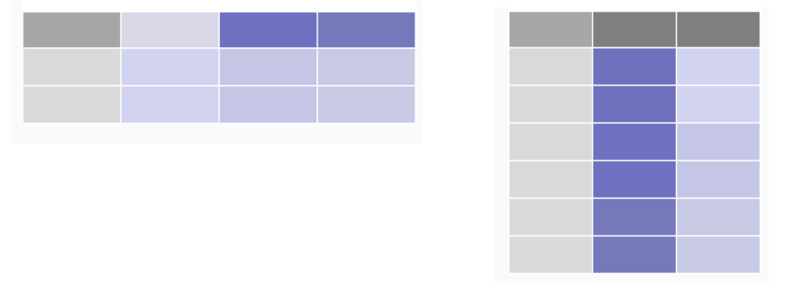{width="80%" fig-align="left"}

## Reestructurando datos con 📦 `tidyr`

<br/> ancho a largo: `pivot_longer()`

::: med-code
```{r}
#| eval: false
#| echo: true
 
pivot_longer(data, cols, 
             names_to, values_to)
```
:::

<br/> largo a ancho: `pivot_wider()`

::: med-code
```{r}
#| echo: true
#| eval: false
 
pivot_longer(data, cols, 
             names_from, values_from)
```
:::

## 

```{r}
#| eval: true
#| echo: false

colonias <- 
tibble::tribble(
    ~Asentamiento,                 ~Tipo,    ~CP, ~Abarrotes, ~Supermercado, ~Minisuper,
  "Arroyo Blanco",             "Colonia", 91025L,         7L,            2L,         1L,
         "Atenas",     "Fraccionamiento", 91184L,         1L,            0L,         2L,
       "Colibris",             "Colonia", 91067L,         8L,            3L,         2L,
      "Del Valle", "Unidad Habitacional", 91097L,         2L,            1L,         1L,
     "El Cafetal",     "Fraccionamiento", 91150L,         2L,            0L,         0L
  )


```

::: panel-tabset
## colonias

```{r}
#| eval: true
#| echo: false

colonias |> gt() |> 
    tab_style(
    cell_text(size = '24px'),
    locations = list(cells_body(),
                     cells_column_labels(everything()),
                     cells_title())) |> 
  tab_options(table.background.color="#f4f4f9")
```

## Datos

```{r panel-chunk-cols}
#| eval: false
#| echo: true

colonias <- 
tibble::tribble(
    ~Asentamiento,                 ~Tipo,    ~CP, ~Abarrotes, ~Supermercado, ~Minisuper,
  "Arroyo Blanco",             "Colonia", 91025L,         7L,            2L,         1L,
         "Atenas",     "Fraccionamiento", 91184L,         1L,            0L,         2L,
       "Colibris",             "Colonia", 91067L,         8L,            3L,         2L,
      "Del Valle", "Unidad Habitacional", 91097L,         2L,            1L,         1L,
     "El Cafetal",     "Fraccionamiento", 91150L,         2L,            0L,         0L
  )

```
:::

¿Qué variables tenemos?

## Ancho a largo

```{r}
#| eval: true
#| echo: true

colonias_largo <- colonias |>
  pivot_longer(
    cols = c(Abarrotes,Supermercado,Minisuper),
    names_to = "tipo_negocio",
    values_to = "n_negocios")
```

```{r}
#| eval: true
#| echo: false

colonias_largo <- colonias |>
  pivot_longer(
    cols = c(Abarrotes,Supermercado,Minisuper),
    names_to = "tipo_negocio",
    values_to = "n_negocios")
```

**`cols`** Las columnas cuyos nombres son datos

**`names_to`** Nombre para la nueva variable que se crea a partir de los nombres de cada `cols`

**`values_to`** Nombre para la variable que se crea a partir de los contenidos de cada columna especificada con **`cols`**

## 

```{r}
#| eval: false
#| echo: true

colonias |>
  pivot_longer(
    cols = c(Abarrotes,Supermercado,Minisuper),
    names_to = "tipo_negocio",
    values_to = "n_negocios")
```

## 

```{r}
colonias |>
  pivot_longer(
    cols = c(Abarrotes,Supermercado,Minisuper),
    names_to = "tipo_negocio",
    values_to = "n_negocios")
```

## Largo a ancho

```{r}
#| eval: false
#| echo: true

colonias_largo |> 
  pivot_wider(names_from = tipo_negocio, 
              values_from = n_negocios)
```

**`names_from`** De cuáles columnas vamos a tomar valores para los nombres de las nuevas variables

**`values_from`** Cuál columna tiene los valores de celda para las nuevas variables creadas

## 

```{r}

colonias_largo |> 
  pivot_wider(names_from = tipo_negocio, 
              values_from = n_negocios)
```

## Ejercicio - pivot {background-color="#6aa3b8"}

-   Carga el archivo "`expresion_genes.csv`". Esta tabla contiene valores de expresión génica para cinco especies de peces, a partir de muestras tomadas en seis tiempos y de dos tejidos.

-   Transforma los datos de ancho a largo y de regreso a ancho.

# Novedades en `dplyr` 1.2.0

## `filter_out()`

#### El complemento de `filter()`

Para descartar filas. A diferencia de `filter(!condicion)`, **`filter_out()`** conserva los `NA`.

::: med-code
```{r}
#| eval: false
#| echo: true
paises_m |> 
  filter_out(region == "Asia")
```
:::

Evita el error común de perder datos faltantes cuando queremos excluir valores específicos.

## `filter_out()`

```{r}
#| eval: true
#| echo: false

paises_m |> 
  filter_out(region == "Asia")
```


## `replace_values()` y `replace_when()`

#### Reemplazos precisos

`replace_values()` para valores específicos y `replace_when()` para condiciones lógicas

```{r}
#| eval: false
#| echo: true
# replace_values para cambios puntuales
paises_m |> 
  mutate(pais = 
    replace_values(pais, "Congo" ~ "Rep. Dem. del Congo"))

# replace_when para topes o rangos
paises_m |>
  mutate(amenazadas = 
  replace_when(amenazadas, amenazadas > 100 ~ 100))
```

## `replace_values()` 

```{r}
#| eval: true
#| echo: false

paises_m |> 
  mutate(pais = 
    replace_values(pais, "Congo" ~ "Rep. Dem. del Congo"))
```

## `replace_when()`

```{r}
#| eval: true
#| echo: false

paises_m |>
  mutate(amenazadas = 
  replace_when(amenazadas, amenazadas > 100 ~ 100))
```

# Expresiones regulares para trabajar con cadenas de texto

## Expresiones regulares 

Lenguaje para describir **patrones de texto** — buscar, reemplazar o extraer partes de una cadena (🧶 *string*).

**Patrones comunes:**

-   `.` cualquier carácter · `[a-z]` rangos
-   `^` inicio · `$` final de cadena
-   `?` `+` `*` · `{n}` repetición
-   `|` alternancia · `\\d` dígitos · `\\w` palabra · `\\s` espacio


## Regex con 📦 `stringr` y `dplyr`

Funciones con prefijo `str_`:

```{r}
#| eval: true
especies <- c("anthonyi", "daviesi", "jonesi")
# Reemplazar 'i' final por 'ii'
stringr::str_replace(especies, "i$", "ii")
```

```{r}
#| eval: false
# Filtrar filas por contenido de texto
paises |> filter(str_detect(pais, "z"))
```

</br>

::: rightref
::: refbox
Probar y practicar en [regex101.com](https://regex101.com/) o [rubular.com](https://rubular.com/)\
[stringr cheatsheet](https://stringr.tidyverse.org/)
:::
:::


# Información repetida

## Valores repetidos

-   Definición variable pero generalmente dos o más copias del mismo registro u observación

### Problemas posibles

-   Inflan datos

-   Costos de repetición no intencional

-   Resultados imprecisos

## Identificando y eliminando duplicados

-   Identificar con `get_dupes()` del paquete 📦 `janitor`

-   Eliminar con `distinct()` de 📦 `dplyr`

## Repetición

-   En todas las variables (copias idénticas de una fila)

-   En las variables que definen nuestras unidades observacionales

-   En conjuntos arbitrarios de variables

## 

::: panel-tabset
### ordenes_pizza

```{r}
#| eval: true
#| echo: false

tibble::tribble(
    ~IDusuario,            ~Direccion,    ~Colonia,    ~Alcaldia,
    "Pablitoo",  "Cafetal 395 Casa 2", "San Angel", "A. Obregón",
    "susana24",         "Fresnos 114", "San Angel", "A. Obregón",
    "susana24",         "Fresnos 114", "San Angel", "A. Obregón",
  "jd.adriana",  "Cafetal 395 Casa 8", "San Angel", "A. Obregón",
  "JuanManuel", "Hidalgo 11 Depto 1B", "Campestre", "A. Obregón",
   "JoaquinED", "Hidalgo 11 Depto 1B", "Campestre", "A. Obregón",
      "e_ric2", "Hidalgo 11 Depto 1B", "Campestre", "A. Obregón"
  ) |> 
  gt() |>
  tab_style(
    cell_text(size = "26px"),
    locations = list(
      cells_body(),
      cells_column_labels(everything()),
      cells_title()
    )
  )

```

### datos

```{r}
#| eval: true
#| echo: true

ordenes_pizza <- 
tibble::tribble(
    ~IDusuario,            ~Direccion,    ~Colonia,    ~Alcaldia,
    "Pablitoo",  "Cafetal 395 Casa 2", "San Angel", "A. Obregón",
    "susana24",         "Fresnos 114", "San Angel", "A. Obregón",
    "susana24",         "Fresnos 114", "San Angel", "A. Obregón",
  "jd.adriana",  "Cafetal 395 Casa 8", "San Angel", "A. Obregón",
  "JuanManuel", "Hidalgo 11 Depto 1B", "Campestre", "A. Obregón",
   "JoaquinED", "Hidalgo 11 Depto 1B", "Campestre", "A. Obregón",
      "e_ric2", "Hidalgo 11 Depto 1B", "Campestre", "A. Obregón"
  )
```
:::

## Identificar con `get_dupes()`

```{r}
ordenes_pizza |>
  get_dupes() # todas las variables (por defecto)
```

-   Añade una variable `dupe_count` que cuantifica las filas con valores duplicados

-   Acomoda las variables de interés al principio del data frame resultante

## 

`get_dupes()` asignando una variable para definir nuestra unidad observacional

¿Alguien ordenó más de una vez?

```{r}
ordenes_pizza |>
  get_dupes(IDusuario)
```

## 

`get_dupes()` con combinaciones de variables

-   Filas repetidas en dirección \* colonia

> accepta funciones auxiliares de 📦 `tidyselect`

```{r}
ordenes_pizza |>
  get_dupes(Direccion, starts_with("Col"))
```

## 

Descartar con `distinct()` de 📦 `dplyr`

. . .

```{r}
ordenes_pizza |>
  distinct() # todas las variables
```

## 

`distinct()` con la variables que definen las unidades observacionales

```{r}
ordenes_pizza |>
  distinct(IDusuario, .keep_all = TRUE)
```

> `.keep_all` para retener o no las demás columnas

## 

`distinct()` con combinaciones de variables

-   Combinaciones únicas de dirección \* colonia

```{r, eval=TRUE}
ordenes_pizza |>
  distinct(Direccion,Colonia)
```

## 

> ⚠️ Si `.keep_all = TRUE` y hay valores duplicados en otras variables, `distinct` solo retiene la primera fila

```{r}
ordenes_pizza |>
  distinct(Direccion,Colonia, .keep_all = TRUE)
```

## Ejercicio {background-color="#6aa3b8"}

-   Cargar el archivo `murcielagos.csv`

-   ¿De cuántas localidades únicas provienen estos registros?

-   Exportar un archivo con las localidades únicas y nombres de columna en español

    > 💡 Pista: `write_csv()` de 📦 `readr` escribe en la carpeta de trabajo por defecto — con `here()` pueden controlar la ruta, y `write_excel_csv()` si lo quieren abrir en Excel

# ¡Listo!