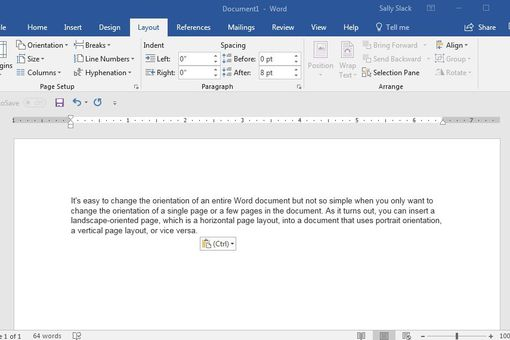
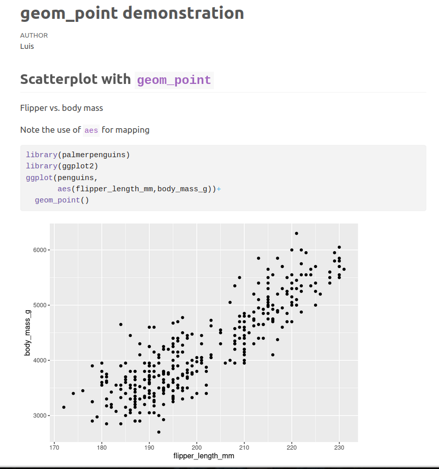

```{r setups}
#| include: false
library(fontawesome)
```

## 

### Combinando texto, código y mucho más

</br>
</br>
R 🔁 Word ➡️ Salida a PDF, HTML, etc.     
</br>
R ➡️ Salida a PDF, HTML, etc

## Markdown `r fontawesome::fa("markdown")`

-   Herramientas y lenguaje para dar formato a documentos sencillos
-   Legible y liviano
-   Portabilidad y conveniencia

## ¿Rmarkdown?

::: columns
::: {.column width="83%"}
-   Formato de archivo y ecosistema de paquetes para combinar texto con formato `r fontawesome::fa("markdown")` markdown y código de R
-   Compatible con HTML
-   Produce un archivo `.md` intermedio que se puede procesar para generar múltiples formatos de salida (PDF, HTML, Word, etc.)
:::

::: {.column width="16%"}
 
:::
:::

## Quarto

::: {style="text-align: right"}
{width="22%"}
:::

. . .

-   Sistema de publicación técnica y científica de código abierto
-   La nueva generación de RMarkdown
-   Multi-lenguaje
-   Multi-formato
-   Bien [documentado](https://quarto.org/docs/guide/)

## 


## Lo que ves es lo que hay (WYSIWYG)

::: columns
::: {.column width="50%"}
{width="650px"}
:::

::: {.column width="50%"}
{width="650px"}
:::
:::

## Fuente y salida por separado

::: columns
::: {.column width="50%"}
```         
---
title: "Demostración de geom_point"
author: "Luis"
format: 
  html:
  theme: pulse
highlight-style: breeze  
---

## Gráfico de dispersión con `geom_point`
Aleta vs. masa corporal
```

````         
``` {{r}}
#| warning: false 
library(palmerpenguins)
library(ggplot2)
ggplot(penguins,aes(flipper_length_mm,body_mass_g))+geom_point()
```
````
:::

::: {.column width="50%"}

:::
:::

## Documentos dinámicos

Combina texto, código, resultados de código, imágenes y resultados 


## Formatos de salida

<br>

::: {style="font-size: 3em; text-align: center; color: #4194c5"}
`r fontawesome::fa("blog")` `r fontawesome::fa("file-pdf")` `r fontawesome::fa("file-code")` `r fontawesome::fa("file-powerpoint")` `r fontawesome::fa("book")` `r fontawesome::fa("book-open")` `r fontawesome::fa("python")`
:::

::: columns
::: {.column width="50%"}
Blogs\
PDF\
Informes\
Manuscritos\
:::

::: {.column width="50%"}
Presentaciones\
Libros\
Cursos\
Notebooks
:::
:::

## ¿Tengo Quarto?

-   Instalado automáticamente con RStudio desde la versión v2022.07
-   Instalar desde la [página oficial de descarga](https://quarto.org/docs/download/)

La versión actual es: v1.11.9

`quarto --version` en la terminal para verificar la versión instalada

# Nuevos archivos Qmd {background-color="black"}

-   Crear con el menú 'File' en RStudio o Positron
-   Crear con cualquier editor de texto

## Dando formato al texto

Ciertos caracteres toman significados especiales en `r fontawesome::fa("markdown")`, así que los usamos para definir el formato<br><br>

::: columns
::: {.column width="50%"}
\*cursiva\* y \*\*negrita\*\*\
superíndice\^2\^\
subíndice\~2\~\
\~\~tachado\~\~\
\`código\`
:::

::: {.column width="50%"}
*cursiva* y **negrita**\
superíndice^2^\
subíndice~2~\
~~tachado~~\
`código`
:::
:::

## Encabezados

Definen secciones y subsecciones, y se procesan para crear tablas de contenido

+----------------+---------------+
| Markdown       | Resultado     |
+================+===============+
| ```            | # Nivel 1     |
|  # Nivel 1     |               |
| ```            |               |
+----------------+---------------+
| ```            | ## Nivel 2    |
| ## Nivel 2     |               |
| ```            |               |
+----------------+---------------+
| ```            | ### Nivel 3   |
| ### Nivel 3    |               |
| ```            |               |
+----------------+---------------+
| ```            | #### Nivel 4  |
| #### Nivel 4   |               |
| ```            |               |
+----------------+---------------+

## Imágenes

Agregar desde una ruta local o desde la web

``


## Código

#### Bloques de código (chunks)

Insertar con `ctrl + shift + I` o el botón del IDE

El contenido del bloque se ejecuta

```{r}
#| echo: fenced
sqrt(64)
log(1000)
25*12
```


##

> El resultado de la ejecución del código aparece en la salida


Podemos controlar si el código se muestra, se ejecuta o se oculta, así como qué hacer con los errores o advertencias.


## Preámbulo YAML

Contiene los metadatos del documento para especificar:

-   Opciones visuales que se aplican en todo el documento  

-   Información de autor y fecha

-   Formato de salida

-   `---` antes y después del preámbulo

## Ejemplo 1: Reporte de zarigüeyas {background-color="black"}

-   cambiar el [tema](https://quarto.org/docs/output-formats/html-themes.html#overview) (`theme`)
-   cambiar el [resaltado](https://quarto.org/docs/output-formats/html-code.html#highlighting) de código (`highlight style`)
-   ocultar o mostrar [código](https://quarto.org/docs/output-formats/html-code.html#folding-code) (`code-fold`, `code-tools`, `code-summary`)

## Ejemplo 1: solución {background-color="black"}

```         
---
title: "Reporte de mediciones de zarigüeyas"
author: "Tu nombre aquí"
format:
  html:
    theme: pulse
    code-fold: true
    code-tools: true
    code-summary: "Mostrar el código"
highlight-style: breeze
---
```

## Múltiples formatos de salida

Un mismo documento puede generar varios formatos a la vez (por ejemplo Word y PDF), declarándolos en el YAML

-   `quarto render documento.qmd` genera **todos** los formatos
-   `quarto render documento.qmd --to docx` genera solo uno
-   En RStudio, el menú del botón *Render* permite elegir el formato


## 

```         
---
title: "Mi reporte"
author: "Tu nombre aquí"
format:
  html: default
  docx: default
  pdf: default
---
```

## Presentaciones

Quarto usa el framework `reveal.js` para crear presentaciones HTML

-   Incluye herramientas para el presentador

-   Nuevas diapositivas delimitadas con `---` o creadas con encabezados de nivel dos (`##`)

## Ejemplo 2: Presentación sobre mascotas {background-color="black"}

-   [Aparición](https://quarto.org/docs/presentations/#incremental-lists) gradual de listas y viñetas
-   Cambiar el fondo de diapositivas `{background-color}`
-   Exportar a PDF (la tecla `E` activa la vista previa de impresión)
-   `F` para pantalla completa

## Ejemplo 2: solución {background-color="black"}

```         
---
title: "Mi mascota"
author: "Tu nombre aquí"
format:
  revealjs:
    transition: fade
---
```

``` {.markdown code-line-numbers="false"}
## A mi mascota le gusta

::: incremental
- comer
- jugar
- dormir
:::

# Cambiando de tema {background-color="yellow"}
```

## Compartiendo documentos Quarto

### Renderizar y compartir
- como HTML (`embed-resources`), PDF, PPT, etc.

```         
---
title: "Mi reporte"
format:
  html:
    embed-resources: true
---
```

### Publicar en Posit Connect

Gratis para documentos no muy pesados

### Publicar en GitHub Pages, Netlify, etc.

## Lecturas útiles

📃 Meghan Hall - [Making Slides in Quarto with reveal.js](https://meghan.rbind.io/blog/quarto-slides/)

📒 Thomas Mock - [Getting Started with Quarto](https://rstudio-conf-2022.github.io/get-started-quarto/)

# ¡Gracias!
