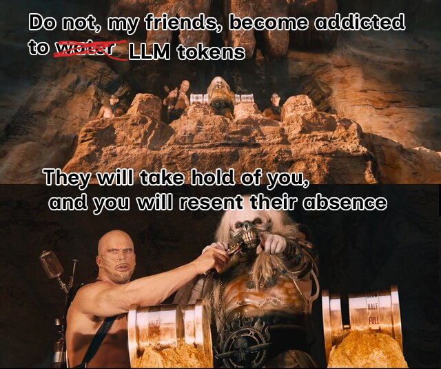

```{r fa packages setup}
#| echo: false
library(fontawesome)
```

## 🤝 

- ¿Te gusta/entusiasma/aterra la IA? <br>
- ¿Alguna sorpresa grata con alguna herramienta de IA? <br>
- ¿Alguna mala experiencia?

## 

</br> </br>

Usaremos modelos alojados en la nube 

## LLaves de API

Necesitamos identificarnos con el proveedor del modelo y autenticar nuestra conexión cifrada a sus servidores


#### Flujo general

- Crear una cuenta con un proveedor(💳 ?)
- Generar una clave de API
- Mantenerla segura pero accesible para nuestras herramientas
- Para algunas suscripciones iniciamos sesión en el navegador en lugar de con llaves de API

## LLaves de API

### En R

La mayoría de los paquetes funcionan con llaves almacenadas en variables de entorno.

### En asistentes con GUI

Ingresamos nuestras claves de forma interactiva

</br>

⚠️ Nunca compartas claves en repositorios públicos, unidades de red, documentos compartidos o grabaciones de pantalla.

::::::: rightref
:::::: refbox
::::: columns
::: {.column width="50%"}
H. Wickham <br> [Managing secrets](https://cran.r-project.org/web/packages/httr/vignettes/secrets.html)
:::

::: {.column width="50%"}
Ted Laderas <br> [A gRadual introduction to web APIs and JSON](https://www.youtube.com/watch?v=HA7KfdEsdpo)
:::
:::::
::::::
:::::::

## Configuración de API

Hoy usarermos llaves para un proveedor popular. Se desactiva sola más tarde.

## Suscripciones, prepago y claves de API

- El precio depende del uso

- Las suscripciones van de \~1 a 250 USD/mes, con límites en el número de peticiones y/o tokens

- Existe la opción de prepago de saldo

- Los tokens son la moneda básica de los LLMs, aproximadamente equivalentes a palabras

[Comparación de costos 2026](https://atxp.ai/blog/ai-api-cost-comparison/) por ATPX

##


## 




## Probabilidades de tokens

Aplicación "Token Possibilities" por Garrick Aiden Buie

[App original de 2025](https://github.com/posit-conf-2025/llm/blob/f41bb7edd37f20a44ec76cb35e9791bd60082837/_demos/04_token-possibilities/app.R)

## Configuración - R

Temporal: `Sys.setenv(OPENAI_API_KEY = "clave_api")` (entre comillas) o "`ANTHROPIC_API_KEY`" o "OPENROUTER_API_KEY" o cualquier otro proveedor

Permanente: `usethis::edit_r_environ()`

En herramientas con interfaz gráfica podríamos también necesitar ingresar una URL base\
(ej. https://openrouter.ai/api/v1)

## Archivos del taller

Descargar y extraer el archivo comprimido desde la página de materiales

