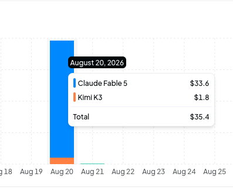

# Contexto

## Los LLM pueden ayudarnos con:

::: large-font-slide
Generación de texto, traducción, análisis de sentimiento, escritura y depuración de código, texto a voz, voz a texto, generación de imágenes y videos, etc.
:::

## ¿Dónde están los modelos? ¿Quién los crea?

- [OpenAI](https://openai.com/) (serie GPT incluyendo ChatGPT)
- [Google AI](https://ai.google.dev/) (Modelos Gemini)
- [Anthropic](https://www.anthropic.com/) (Modelos Claude)
- [DeepSeek](https://www.deepseek.com/en) (DeepSeek R1)
- [Z AI](https://z.ai) (Modelos GLM)
- [Moonshot AI](https://www.moonshot.ai/) (Modelos Kimi)

## Modelos != Proveedores

Las empresas entrenan y publican modelos para diferentes casos de uso

::: incremental
- Modelos generales, ligeros, para programación, etc.
- Los modelos pueden ser abiertos o propietarios
- Los proveedores pueden alojar múltiples modelos de diferentes creadores
- Los chats web incluyen modelos + varias herramientas (que no siempre son evidentes)
:::

## Veamos

::: large-font-slide
- [Tablero de clasificación](https://artificialanalysis.ai/leaderboards/models) de LLM
:::

## Modelos en la nube

:::::: columns
::: {.column width="50%"}
- Configuración 'sencilla'
- Crear cuenta, configurar facturación si aplica, obtener una clave de API
- Acceso a modelos nuevos y en desarrollo, y gran capacidad de cómputo (incluso modelos sorpresa)
:::

::: {.column width="50%"}
- Puede ser costoso

- Necesitamos acceso a internet

- Enviamos nuestros datos a la API
:::
::::::

## Modelos locales

Descargar modelos más pequeños en nuestro propio hardware

:::::: columns
::: {.column width="43%"}
- Los datos no se comparten con un proveedor
- Sin costos continuos
- Funcionan sin conexión
:::

::: {.column width="4%"}
:::

::: {.column width="43%"}
- Curva de aprendizaje pronunciada
- Requisitos de memoria grandes
- Rendimiento más lento
:::
::::::

 

## ¿Qué modelo uso?

### Consideraciones

::::: columns
::: {.column width="50%"}
- Precio
- Cuentas gratuitas, precio por token, políticas de facturación
- Ventanas de contexto
- **Compatibilidad con nuestras herramientas elegidas**
- Velocidad
:::

::: {.column width="50%"}
- Rendimiento
- Privacidad
- Hardware
:::
:::::

## Eligiendo modelos

Sugerencia de [Sara Altman y Simon Couch](https://opensource.posit.co/blog/2026-08-14_ai-newsletter/#fn:1):

- Encontrar el límite superior de lo que podemos hacer con el modelo más caro al que tengamos acceso (de preferencia como parte de una promo o prueba gratis) y comparar la misma tarea con modelos más económicos

##

## No tengo una macbook m5 ni $$$

- Github Copilot en un plan académico de [GitHub Educatuion](https://github.com/education)
- Cuenta gratuita en [Groq](https://groq.com)
- [Gemini Code Assist for individuals](https://geminicli.com/docs/resources/quota-and-pricing/) con cuenta Google
- Mes de prueba gratuito en [Posit AI](https://posit.ai/)

# Programando con LLM

## Cambios de contexto

Cambiar nuestra atención entre diferentes tareas o programas cansa y quita productividad

::: incremental
- Preguntar al chatbot en el navegador
- Copiar la respuesta y pegarla en R
- Compartir los errores o resultados con el chat
- Repetir (y potencialmente introducir errores)
:::

## Programar con LLM

 

### Autocompletar

 

- Los modelos sugieren 'texto fantasma' mientras escribimos\
- Distrae mucho en docencia\
- Las sugerencias pueden no ser útiles pero son mayormente inofensivas

## Programar con LLM

 

### Chats

 

- Enviamos prompts, obtenemos respuestas
- A menudo nos permiten proveer contexto y subir archivos
- Los resultados se pueden copiar o insertar directamente en un script
- En el navegador o a través de APIs

## Programar con LLM

 

### Agentes

::: incremental
- Pueden ejecutar código y modificar archivos
- Formulan y siguen planes
- Consumen muchos tokens
- Nos hacen asumir que los resultados son correctos
- Pueden usar archivos con 'habilidades', recordar preferencias e interacciones previas
:::

# Conversaciones con LLM

## ¿Qué preguntas podríamos poner en una ventana de chat de LLM?

 

::: retro-console-window
\> ¿Cómo agrego un subtítulo a mi figura de ggplot?\
\> ¿Cuáles son los argumentos de pivot_wider()?\
\> No puedo unir mi objeto tabla_1 con mi data frame dat3, ¡ayuda!
:::

 

. . .

Notemos la diferencia en el tipo de pregunta. Esto será importante pronto.

## Los LLM no tienen estado

## Los LLM no tienen estado

- No retienen memoria de interacciones previas

- El contexto se logra enviando todos los mensajes previos con cada nueva petición

- Debido a limitaciones de tokens y tamaño de contexto, hay estrategias para truncar, optimizar, o dejar archivos con apuntes persistentes

## Los LLM no tienen estado

::: {large-slide-text}
- Inicia nuevos chats a menudo

- Divide tareas entre chats

- Usa prompts de sistema detallados
:::

## Los modelos por sí solos no pueden actuar en el mundo

## Los modelos por sí solos no pueden actuar en el mundo

- Un modelo solo sabe lo que "aprendió" durante el entrenamiento, más lo que está en su ventana de contexto
- No puede navegar internet, ejecutar código o leer archivos en nuestra computadora por sí mismo
- No puede consultar el clima, leer una página web o abrir un CSV a menos que algo le dé esa capacidad

## Herramientas

- Las herramientas permiten que un modelo solicite una acción: buscar en la web, leer/escribir un archivo, ejecutar código, consultar una base de datos

- El modelo no realiza la acción por sí mismo — la solicita, y un programa ejecuta la petición y le devuelve el resultado
- Esta es la base de los flujos de trabajo "agénticos"

# Preguntas
